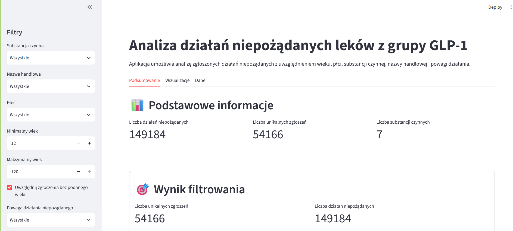
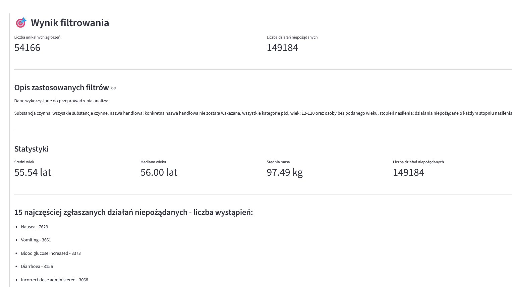
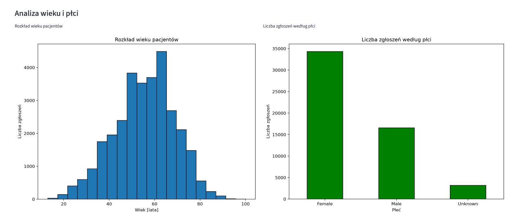
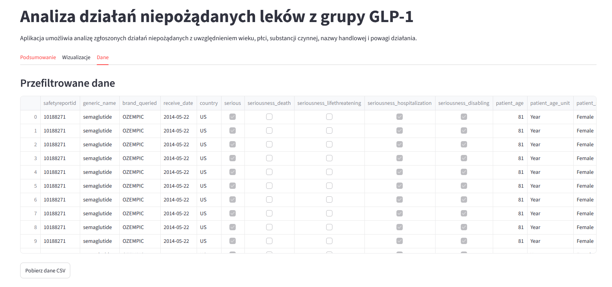

# Analiza działań niepożądanych leków z grupy GLP-1

## Opis projektu

Aplikacja internetowa napisana w języku Python, służąca do analizy zgłoszeń dotyczących działań niepożądanych leków z grupy GLP-1. Umożliwia filtrowanie danych, obliczanie podstawowych statystyk, analizę wyników za pomocą wykresów oraz eksport danych i raportów.

## Funkcjonalności

- Filtrowanie zgłoszeń według substancji czynnej, nazwy handlowej, płci, wieku i powagi działania niepożądanego.
- Uwzględnianie zgłoszeń bez podanego wieku pacjenta.
- Prezentacja podstawowych statystyk dla przefiltrowanych danych.
- Wyświetlanie najczęściej zgłaszanych działań niepożądanych.
- Generowanie sześciu rodzajów wizualizacji.
- Eksport przefiltrowanych danych do pliku CSV.
- Generowanie raportu z analizy w formacie PDF.

## Technologie

- Python
- Streamlit
- pandas
- Matplotlib
- Seaborn
- ReportLab

## Struktura projektu

- `app.py` — główny plik aplikacji.
- `visualizations.py` — moduł odpowiedzialny za wizualizacje.
- `requirements.txt` — lista wymaganych bibliotek.
- `specyfikacja.md` — szczegółowa specyfikacja aplikacji.
- `README.md` — opis projektu i instrukcja uruchomienia.

## Instalacja i uruchomienie

### 1. Pobranie repozytorium

Sklonuj repozytorium i przejdź do katalogu projektu.

```bash
git clone https://github.com/AnnaMaek/ProjektSemestralny.git
cd ProjektSemestralny
```


### 2. Utworzenie środowiska wirtualnego

```bash
python -m venv .venv
```

### 3. Aktywacja środowiska

Windows — PowerShell:

```powershell
.\.venv\Scripts\Activate.ps1
```

Windows — wiersz polecenia (CMD):

```bat
.venv\Scripts\activate.bat
```

### 4. Instalacja zależności

```bash
python -m pip install -r requirements.txt
```

### 5. Uruchomienie aplikacji

```bash
streamlit run app.py
```

Po uruchomieniu aplikacja będzie dostępna pod adresem lokalnym wyświetlonym w terminalu przez Streamlit.

## Źródło danych

Aplikacja korzysta z pliku CSV zawierającego zgłoszenia działań niepożądanych leków z grupy GLP-1. Źródłem zbioru jest serwis Kaggle.

## Ograniczenia

Wyniki analizy zależą od jakości i kompletności danych źródłowych. Zgłoszenie działania niepożądanego nie oznacza automatycznie, że zostało ono spowodowane przez dany lek. Wyniki mają charakter analityczny i należy je interpretować z uwzględnieniem ograniczeń zbioru danych.

## Wykorzystanie AI

Podczas realizacji projektu korzystano z narzędzi sztucznej inteligencji (AI) jako wsparcia na poszczególnych etapach pracy. AI pomogło w opracowaniu koncepcji i struktury aplikacji, zaplanowaniu kolejnych etapów jej rozwoju oraz zaprojektowaniu interfejsu graficznego.

Narzędzia AI wykorzystano również do wsparcia implementacji funkcjonalności aplikacji, w tym filtrowania danych i generowania raportów w formacie PDF. Pomagały także w analizowaniu logiki działania programu, identyfikowaniu i poprawianiu błędów, doskonaleniu kodu oraz poprawianiu błędów językowych i stylistycznych w dokumentacji.

AI stanowiło narzędzie wspomagające proces tworzenia aplikacji, rozwój jej funkcjonalności oraz przygotowanie dokumentacji.

## Zrzuty ekranu

### Strona główna — podsumowanie danych


### Przykładowe wyniki filtrowania


### Wizualizacje danych


### Tabela przefiltrowanych zgłoszeń


